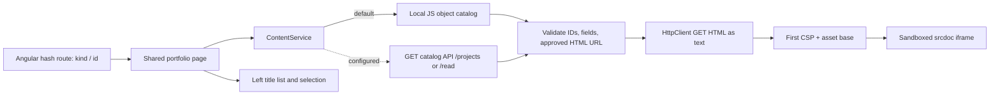

# Portfolio content boundary

`content.models.ts` defines the shared metadata/config contract.
`content.catalog.ts` supplies the current fixtures and deployment configuration.
`ContentService` switches fixture/API catalogs, validates them, fetches documents
and constructs the isolated viewer input. `PortfolioPage` maps the route to
catalog/content state, cancels obsolete requests, updates titles and handles
loading, retry, empty/missing/error states. A new item is content plus metadata;
no component or route definition is required for each item.

The application owns navigation/selection/status; standalone HTML owns its
presentation. Script execution, same-origin parent access, form submission,
embedded frames and top navigation remain disabled. User-activated source links
can open independent tabs. See README for CSP, CORS and approved-origin setup.

No backend service, S3 resource or EKS implementation is part of this application.
The older static portfolio is kept for provenance rather than used as a runtime
fallback. Project HTML/assets are copied into the Angular build by the existing
public asset configuration. Read articles are maintained separately in public/read.

Readings share `public/read/reading.css` and statically highlighted, script-free code panels. The catalog publishes nine Dev notes; Linux essentials is integrated into the EKS implementation/delivery article. Its former Angular route redirects to the merged document; the former static HTML URL provides a redirect link. Dev note figures are semantic HTML resource groups with CSS flows/parallel branches, responsive single-column stacking, and no image or Mermaid rendering dependency. Their naming/ports/paths follow the EKS lab implementation-resource-map.md contract. The Dev notes menu retains /read routes for link compatibility.

The content contract optionally accepts a nonempty `topic` string. ContentService validates/preserves it; the sidebar labels contiguous article groups while the same ID-based routes and HTTP loader remain in use. The catalog contains six project pages and nine Dev notes. Bedrock documentation is a proposed adapter, not a callable feature of this static portfolio or the current local dispatcher.

The EKS project document adds a locally styled AWS boundary map: global DNS, managed control plane, customer VPC/subnet tiers, workers, pods and containers, with separate request/response, async and control relationships. `public/projects/eks-architecture.css` is scoped to this document; resource/HTTP assumptions are maintained in the EKS lab walkthrough.

The agents/runtime article is a continuous document styled by
`public/projects/agents-runtime.css`. It preserves the four existing runtime
Mermaid diagrams and adds a proposed memory read/write diagram. Embedded Python
examples describe boto3/Bedrock embeddings and managed OpenSearch document
retrieval; they are documentation, not executed application code. No memory
export, AWS client or vector backend is wired into the portfolio runtime.

Runtime Controller is the first project entry. Its standalone article documents
the sibling visual-agent-builder implementation using source excerpts and labeled
illustrative payloads. It uses shared reading CSS and an opening native HTML video player. The bundled
MP4 is a 1280-pixel-wide export of the supplied screen recording, with metadata preload and
user-initiated playback. The reader CSP permits only that exact media URL; script,
network API, nested-frame and sandbox restrictions remain in place.

The portfolio is light-only: the shell no longer reads theme localStorage or
exposes a theme switch. ContentService always marks its isolated document light
and includes the same-origin `read/light.css` stylesheet. Existing iframe/CSP
boundaries remain intact. Runtime Controller includes a pre-rendered Mermaid
SVG with an adjacent editable .mmd source, and its standalone HTML loads the
same light stylesheet. Table backgrounds and syntax colors share that palette.
