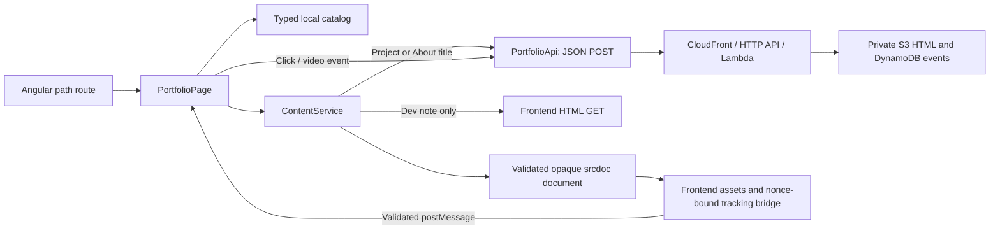

# Portfolio frontend boundary

`content.catalog.ts` owns the static title/route inventory and public endpoint.
`content.models.ts` defines that contract. `portfolio-api.service.ts` owns tab
sessions, typed event construction, bounded POST requests, retries and independent
logging. No browser code has AWS credentials or the origin header secret.

`PortfolioPage` resolves routes, updates the page title, discards obsolete
responses, preserves the last successful view during loading/failure, and offers
retry. Route reuse keeps the viewer alive across section changes; navigation-end
snapshots prevent mixed route data from triggering duplicate content requests.
It stages an inert incoming frame until the validated bridge reports its load event, ignores stale
loads, and preserves the displayed frame through a bounded asset-load timeout.
Tracking accepts events only from the displayed frame. Reveals respect reduced
motion. Frame readiness does not add a second page-view event.
A capture-phase host listener records clicks before Angular navigation;
it is removed on destruction. Native keyboard link activation is the same click,
not a second event. Direct routes/back/refresh request content without fabricated
clicks. Root redirects to the first project, whose content request is its view event.

`ContentService` validates API content responses and builds the isolated document.
Project/About content comes only from the POST endpoint. Read articles still use
frontend GET plus a logging-only page view. The complete original payload is
retained for retry, including event ID, session, client timestamp and metadata.

`tracking-bridge.ts` contains the only script allowed in the opaque iframe. The
loader strips fetched scripts and event handlers, injects a fresh nonce/CSP, and
never grants `allow-same-origin`. Parent message validation requires the current
frame window, origin `null`, matching document ID/channel and bounded event fields.
The bridge handles links, CSS tab controls and actual video playback transitions.
A frontend-injected Play/Pause button provides observable click events; browser-owned
media-control clicks are not exposed to JavaScript and are never fabricated.
The content cannot call the API itself. External navigation remains native and
analytics delivery is best effort. Images/styles/media stay frontend-owned; only
the bundled demo video is permitted by the media policy.

The seven project documents and About HTML, infrastructure, backend tests and
content checks now belong to the sibling `gb-portfolio-aws` project. Its stack
creates private versioned S3, retained DynamoDB with expiring events, Lambda,
HTTP API and a no-cache CloudFront distribution. The public API serves owner-authored
HTML to any visitor; private storage is not content authentication. Approximate
geolocation and anonymous tab sessions do not identify a verified person.

The frontend retains seven project catalog entries and nine Dev notes. Three project
entries and the Dev notes menu are temporarily hidden; direct routes remain.
Reading CSS, light theme overrides, source Mermaid files and SVGs remain here.
Article examples still describe their own projects; proposed Bedrock or EKS
features in those articles are not implemented portfolio services.

Frontend tests cover payload/session/retry semantics, navigation, document
validation, iframe message isolation and event handling. Supplemental headless
checks and native Computer Use evidence are recorded separately from unit tests.
The existing GitHub Pages workflow publishes a selected source revision after
frontend tests/build; infrastructure deployment remains outside this repository.

The production build emits an app entry index for every catalog route and legacy
alias, plus a 404 app shell. Known deep links work on static hosting without
hash routing; unknown paths keep HTTP 404 and show Angular's not-found view.
Legacy hash bookmarks are converted with same-origin history replacement before
bootstrap, preserving their query/anchor without creating a second page visit.
