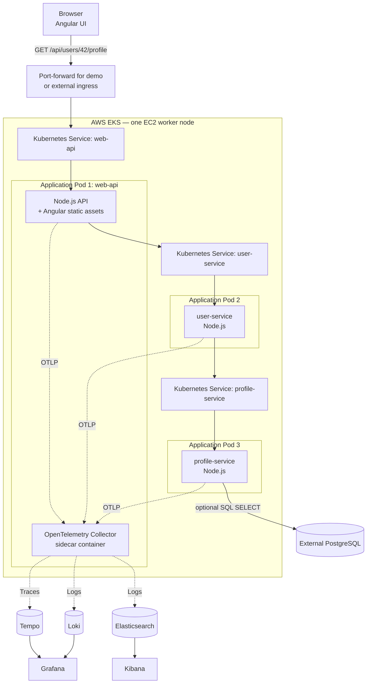
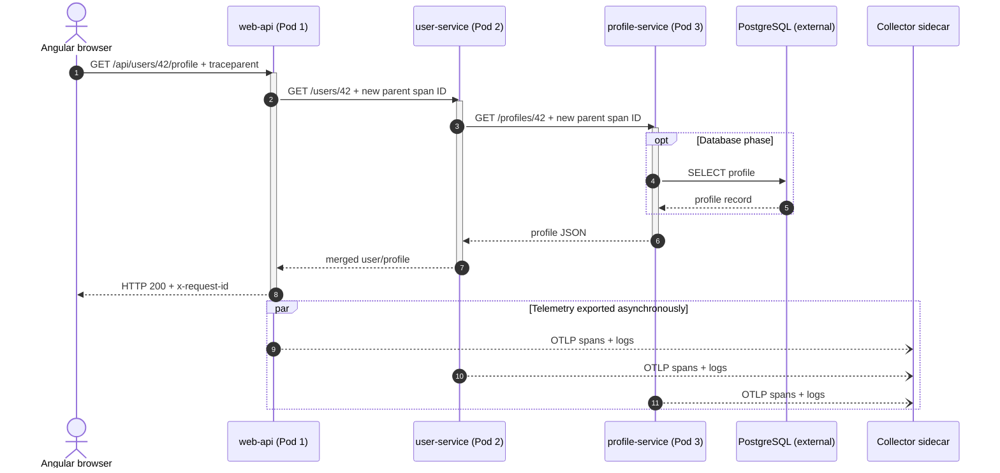
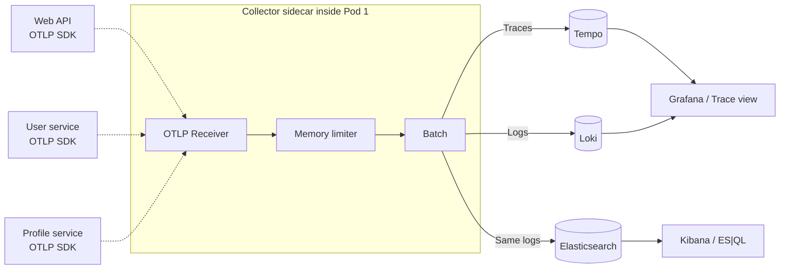
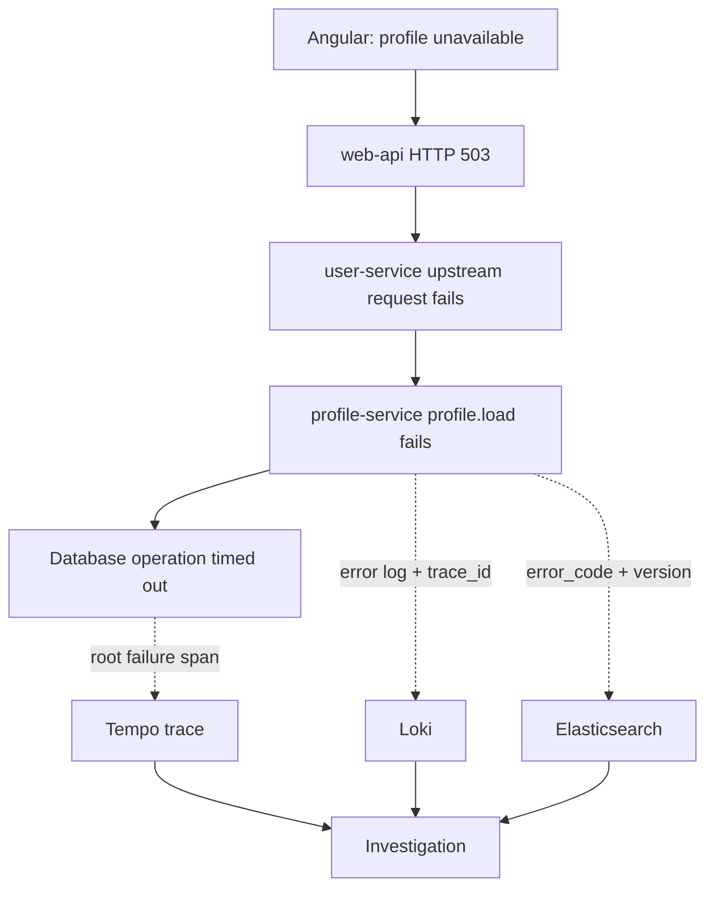

# OpenTelemetry in Practice

## Distributed Instrumentation, Collector Pipelines, and Error Analytics with Tempo, Loki & Elasticsearch

> **Project type:** Cloud-native full-stack observability engineering  
> **Status:** Implementation blueprint / portfolio reference — deployment results are to be added after validation  
> **Target environment:** AWS EKS, **one EC2 worker node**, **three application pods**  
> **Stack:** Angular · Node.js/TypeScript · Kubernetes/EKS · OpenTelemetry · Grafana Tempo · Grafana Loki · Elasticsearch · Kibana

---

## Project overview

A failed HTTP request rarely identifies its own cause. The error shown in a web browser may be the final symptom of a timeout or exception several services downstream. This project demonstrates how to follow a request through a deliberately small Kubernetes application, reconstruct its execution tree, collect correlated errors, and analyze failure trends across deployments.

The design limits the application to **one EKS worker node and three pods** so the work is about instrumentation and investigation rather than the number of microservices. An OpenTelemetry Collector runs as a **sidecar container inside the first pod**. Tempo, Loki, Elasticsearch, Grafana, Kibana, and an optional PostgreSQL database run **outside that three-pod application environment**.

### Outcomes to demonstrate

- Trace a browser-triggered API call across all three Node.js services with one `trace_id` and nested spans.
- Connect error logs and exceptions to the spans that produced them.
- Receive OTLP telemetry in a Collector, batch it, and fan out **traces to Tempo**, **logs to Loki**, and **the same logs to Elasticsearch**.
- Use Kibana ES|QL for **error frequency**, **exception grouping**, **deployment comparisons**, and **trace lookup**.
- Reproduce controlled service and database failures, identify the originating operation, and verify the telemetry pipeline during outages.
- Preserve simple workload boundaries while explaining where production deployments would differ.

**Not in scope:** ECS, OAuth 2.0/OIDC, an in-cluster analytics worker, an extra Prometheus/Grafana stack inside the EKS node, or a replacement for Grafana/Kibana. Operational analytics run in Elasticsearch/Kibana instead.

---

## 1. System architecture

### 1.1 Deployment topology




**Network detail:** both `web-api` and `otel-collector` Kubernetes Services select Pod 1, but target *different container ports on the pod's shared network namespace*. Pod 1 sends telemetry to `localhost:4318`; Pods 2 and 3 send it to `otel-collector.demo.svc.cluster.local:4318`. Service communication uses internal ClusterIP addresses. Start with `kubectl port-forward` to avoid a public AWS load balancer until the trace pipeline works.

> **Pod-count clarification:** three application pods, not three total Kubernetes pods. A functioning EKS worker node also runs Kubernetes and AWS system components. The Collector is an additional container in Pod 1. This single collector is intentionally a single point of failure in the demo.

### 1.2 Application responsibilities

| Workload | Inbound operation | Outbound dependency | Trace instrumentation |
|---|---|---|---|
| **Pod 1: `web-api`** | `GET /api/users/:id/profile` | `user-service` | HTTP server/client, `api.loadProfile`, error middleware |
| **Pod 2: `user-service`** | `GET /users/:id` | `profile-service` | HTTP server/client, `user.getDetails` |
| **Pod 3: `profile-service`** | `GET /profiles/:id` | Optional external PostgreSQL | HTTP server, `profile.load`, SQL client |
| **Collector sidecar** | OTLP/HTTP, OTLP/gRPC | Tempo, Loki, Elasticsearch | Receive/process/export; self-telemetry |

The initial implementation returns mock profile data; PostgreSQL is introduced only after the cross-pod traces have been verified. This keeps debugging focused on one boundary at a time.

### 1.3 Request sequence



The application request never goes *through* the Collector. Telemetry is exported asynchronously on a separate connection. Load balancers and Kubernetes Services do not create application spans by themselves; instrumented HTTP clients and servers do.

---

## 2. How one request becomes a nested trace

### 2.1 Context propagated between services

```http
GET /api/users/42/profile HTTP/1.1
Host: demo.example.test
traceparent: 00-4bf92f3577b34da6a3ce929d0e0e4736-00f067aa0ba902b7-01
x-request-id: req-82a4
```

- `traceparent` is a **W3C standard** (`version-traceId-parentSpanId-flags`). The trace ID stays the same through the connected request; the parent-span field changes on outgoing calls.
- `tracestate` is optional vendor context and should normally be managed by the SDK.
- `x-request-id` is an **application correlation ID**, useful in API responses and support tickets; it does not replace a trace ID.
- Avoid injecting names, emails, tokens, raw SQL parameters, or any sensitive identifiers into span attributes or baggage.

### 2.2 Representative nested span tree

```text
trace_id: 4bf92f3577b34da6a3ce929d0e0e4736

Angular: ui.profile.load                  [optional browser span]
└── HTTP GET /api/users/42/profile        [browser client]
    └── web-api: HTTP server              [Pod 1]
        └── api.loadProfile               [manual business span]
            └── HTTP GET user-service     [HTTP client]
                └── user-service: HTTP server   [Pod 2]
                    └── user.getDetails
                        └── HTTP GET profile-service
                            └── profile-service: HTTP server  [Pod 3]
                                └── profile.load
                                    └── PostgreSQL SELECT [optional]
```

Each span contains `trace_id`, `span_id`, optional `parent_span_id`, start/end timestamps, status, resource (`service.name`, `service.version`), and operation-specific attributes. The Collector forwards spans independently. **Tempo reconstructs the execution tree** from the trace IDs, parent IDs, and timing.

Browser SDK instrumentation is **optional for the first release** because the OpenTelemetry browser instrumentation ecosystem remains experimental. If it is disabled, the trace can legitimately begin at the `web-api` HTTP server span. When enabled, verify Angular's actual HTTP transport, asynchronous context, and same-origin header propagation.

---

## 3. Instrumentation design

### 3.1 What to instrument

| Component | Automatically instrumented | Add manually | Failure evidence |
|---|---|---|---|
| Angular browser | Fetch/XHR (supported, pinned browser SDK) | `ui.profile.load`, `ErrorHandler` integration | Client-side exceptions, HTTP failures |
| `web-api` | Express/HTTP client + server | `api.loadProfile` | Upstream response code and latency |
| `user-service` | Express/HTTP client + server | `user.getDetails` | Downstream call failure |
| `profile-service` | Express/HTTP; `pg` later | `profile.load` | SQL timeout, invalid data, upstream retries |
| All three Node.js apps | Pino trace-log correlation | Stable error codes, release metadata | Log rows linked to active span |
| Collector | Internal exporter/receiver metrics | Queue and export failure alerting | Dropped/retried telemetry |

### 3.2 OpenTelemetry Node.js bootstrap

Initialize **before** importing Express, Pino, HTTP clients, or `pg`. Use one common instrumentation module in all three Node.js applications:

```javascript
// instrumentation.cjs — illustrative Node.js entrypoint
const { NodeSDK } = require('@opentelemetry/sdk-node');
const { getNodeAutoInstrumentations } = require('@opentelemetry/auto-instrumentations-node');
const { OTLPTraceExporter } = require('@opentelemetry/exporter-trace-otlp-http');
const { OTLPLogExporter } = require('@opentelemetry/exporter-logs-otlp-http');
const { BatchLogRecordProcessor } = require('@opentelemetry/sdk-logs');

const base = process.env.OTEL_EXPORTER_OTLP_ENDPOINT;
const sdk = new NodeSDK({
  traceExporter: new OTLPTraceExporter({ url: `${base}/v1/traces` }),
  logRecordProcessors: [
    new BatchLogRecordProcessor(
      new OTLPLogExporter({ url: `${base}/v1/logs` })
    )
  ],
  instrumentations: [getNodeAutoInstrumentations()],
});
sdk.start();

process.on('SIGTERM', () => {
  sdk.shutdown().finally(() => process.exit(0));
});
```

Run with `node --require ./instrumentation.cjs server.cjs`. Configure `OTEL_SERVICE_NAME` separately for each workload; configure `OTEL_EXPORTER_OTLP_ENDPOINT` as `http://127.0.0.1:4318` in Pod 1 or `http://otel-collector.demo.svc.cluster.local:4318` in Pods 2–3. Pin mutually compatible JS SDK and instrumentation package versions in the project lockfile.

`@opentelemetry/instrumentation-pino` supports both trace correlation and forwarding to the OpenTelemetry Logs SDK, when that SDK is configured. **Choose one ingestion path** (Pino → OTLP as shown), rather than also collecting the same stdout logs and doubling ingestion.

### 3.3 Manual business span + safe error classification

```typescript
import { trace, SpanStatusCode } from '@opentelemetry/api';
import pino from 'pino';

const tracer = trace.getTracer('profile-service');
const logger = pino();

export async function loadProfile(id: string) {
  return tracer.startActiveSpan('profile.load', async (span) => {
    try {
      return await repository.getProfile(id); // pg span in DB phase
    } catch (err) {
      const code = isDatabaseTimeout(err)
        ? 'PROFILE_DB_TIMEOUT'
        : 'PROFILE_LOAD_FAILED';
      const error = err instanceof Error ? err : new Error('Unknown failure');
      span.recordException(error);
      span.setStatus({ code: SpanStatusCode.ERROR });
      span.setAttribute('app.error.code', code);
      logger.error({
        'app.error.code': code,
        'app.error.fingerprint': `profile.load:${code}`,
        'app.operation': 'profile.load',
        'exception.type': error.name
      }, 'Profile operation failed');
      throw err;
    } finally {
      span.end();
    }
  });
}
```

`repository.getProfile` and `isDatabaseTimeout` are project functions, not OpenTelemetry APIs; the example illustrates where to put instrumentation. Use parameterized SQL, and normalize route templates (`/users/:id`) in telemetry instead of storing raw user identifiers.

Expected business outcomes, such as `404 profile not found`, do not automatically imply a failed *server* operation. Distinguish them from actual timeouts and unhandled exceptions.

### 3.4 Stable resource metadata

```yaml
# Environment variables inside the profile-service Deployment
- name: OTEL_SERVICE_NAME
  value: profile-service
- name: OTEL_RESOURCE_ATTRIBUTES
  value: "service.version=1.2.0,deployment.environment.name=development"
- name: OTEL_EXPORTER_OTLP_ENDPOINT
  value: http://otel-collector.demo.svc.cluster.local:4318
```

Set release metadata from the image tag or CI commit SHA in real deployments. Both `service.name` and `service.version` are **resource attributes**, not one-off attributes you manually attach to each span.

---

## 4. Collector and storage design

### 4.1 Telemetry pipelines




The traces and logs pipelines share receivers and processor definitions but are **configured separately**. This isn't a durable message queue: the Collector has bounded memory/queues, and Tempo, Loki, and Elasticsearch own retention and persistence. The same logical log record in Loki and Elasticsearch is intentional for this portfolio experiment and costs extra storage.

### 4.2 Collector Contrib configuration

The deployable reference is [`observability/collector/collector.yaml`](../observability/collector/collector.yaml). Relevant configuration:

```yaml
receivers:
  otlp:
    protocols:
      grpc: { endpoint: 0.0.0.0:4317 }
      http: { endpoint: 0.0.0.0:4318 }
processors:
  memory_limiter:
    check_interval: 1s
    limit_mib: 256
    spike_limit_mib: 64
  batch:
    timeout: 5s
exporters:
  otlp/tempo:
    endpoint: ${env:TEMPO_OTLP_GRPC_ENDPOINT}
    tls: { insecure: true } # private development lab only
  otlphttp/loki:
    endpoint: ${env:LOKI_OTLP_BASE_URL} # must end in /otlp
  elasticsearch:
    endpoint: ${env:ELASTICSEARCH_ENDPOINT}
    api_key: ${env:ELASTIC_API_KEY}
service:
  pipelines:
    traces:
      receivers: [otlp]
      processors: [memory_limiter, batch]
      exporters: [otlp/tempo]
    logs:
      receivers: [otlp]
      processors: [memory_limiter, batch]
      exporters: [otlphttp/loki, elasticsearch]
```

For Loki OTLP/HTTP use base endpoint `https://.../otlp`: the exporter adds `/v1/logs`. Loki 3+ requires structured metadata enabled (typically enabled by default). Do not use `.../otlp/v1/logs` as the exporter base URL.

The Elasticsearch exporter works with the self-managed Elasticsearch endpoint, using its default **OTel-native** mapping. It does **not** automatically enable the full Elastic APM service map/transaction analytics features; those need Elastic's APM-specific gateway processors. This project uses **Tempo for tracing** and **Kibana for indexed log analytics**.

### 4.3 Kubernetes Collector Service

The Collector sidecar and API share Pod 1's IP but have separate ports:

```yaml
apiVersion: v1
kind: Service
metadata:
  name: otel-collector
  namespace: demo
spec:
  type: ClusterIP
  selector:
    app: web-api
  ports:
    - name: otlp-http
      port: 4318
      targetPort: otlp-http
```

The `otel-collector` container in Pod 1 must expose a port named `otlp-http` on `4318`. The Node.js container exposes its own HTTP port separately (e.g. `8080`). A Deployment/ConfigMap example is in [`observability/kubernetes`](../observability/kubernetes/).

For a public web UI, **never expose OTLP port 4318 openly**. If browser telemetry is enabled, use an authenticated or abuse-controlled same-origin ingestion handler/proxy with size limits, throttling, and field filtering. The simpler initial milestone instruments the backend first.

---

## 5. Failure investigation: from symptom to origin

### 5.1 Controlled incident

**Scenario:** `profile-service` times out while loading a profile. The frontend receives an error through the two upstream Node.js services.



The **symptom** appears in Angular, but the **first failing operation** is the database query. Other spans can also be marked as failed because they propagate the downstream error. Trace trees alone suggest likely origin; logs and supporting database telemetry confirm the diagnosis.

### 5.2 Canonical error log event

Example **illustrative event**, not live telemetry:

```json
{
  "timestamp": "2026-10-21T14:15:00Z",
  "severity_text": "ERROR",
  "service.name": "profile-service",
  "service.version": "1.2.0",
  "trace_id": "4bf92f3577b34da6a3ce929d0e0e4736",
  "span_id": "17dc4388e094f919",
  "app.operation": "profile.load",
  "app.error.code": "PROFILE_DB_TIMEOUT",
  "app.error.fingerprint": "profile.load:PROFILE_DB_TIMEOUT",
  "exception.type": "DatabaseTimeoutError"
}
```

Actual OTLP log records place resource identity (`service.*`), active span context, severity, body, and log attributes in distinct fields; Elasticsearch's OTel-native exporter maps these into its document schema. Verify mapping in Kibana before copying query examples.

### 5.3 Trace-to-logs using Loki

```logql
{service_name="profile-service"}
  | trace_id="4bf92f3577b34da6a3ce929d0e0e4736"
```

Ingested OTLP logs need to preserve `trace_id` as structured metadata. `service_name` is a useful Loki label; **do not index `trace_id` as a Loki label** because it has very high cardinality. Configure Grafana's Tempo/Loki trace-to-logs integration to enable one-click investigation.

---

## 6. Elasticsearch error analytics and Kibana

**Objective:** answer which failures are recurring, when they started, how they vary by service, and whether a deployment likely introduced a regression.

### 6.1 Index schema and version assumptions

- OTel-native logs commonly use Elasticsearch data streams matching `logs-*.otel-*`.
- `severity_text`, `trace_id`, `resource.attributes`, and `attributes` should be inspected in Discover and the index mapping after ingestion.
- **Queries below target Elasticsearch 9.5+** where ES|QL supports `FIELD_EXTRACT` for `flattened` OpenTelemetry attributes. This functionality began as a technical preview; pin and test the exact version. Older versions require an explicit mapping/ingest-pipeline approach, or query mapped top-level fields such as `service.name` when available.
- Use fixed structured log attributes (`app.error.code`, `app.error.fingerprint`, `app.event`, `app.http.status_code`) rather than analyzing free-form text for basic grouping.

Query files are separately provided under [`observability/kibana/queries`](../observability/kibana/queries/).

### 6.2 Error frequency by service and five-minute interval

```esql
FROM logs-*.otel-*
| WHERE @timestamp >= NOW() - 24 hours
| WHERE severity_text == "ERROR"
| EVAL service = FIELD_EXTRACT(resource.attributes, "service.name")
| STATS error_events = COUNT(*) BY service, bucket = BUCKET(@timestamp, 5 minutes)
| SORT bucket ASC
```

**Result:** a timeline showing spikes and their originating services. This measures *error log events*, not distinct failed HTTP requests. A single request could produce multiple error logs.


*Illustrative synthetic data. This is a dashboard design example, not an observed result.*

### 6.3 Exception groups by normalized fingerprint

```esql
FROM logs-*.otel-*
| WHERE severity_text == "ERROR"
| EVAL service = FIELD_EXTRACT(resource.attributes, "service.name"),
       fingerprint = FIELD_EXTRACT(attributes, "app.error.fingerprint"),
       code = FIELD_EXTRACT(attributes, "app.error.code")
| STATS occurrences = COUNT(*) BY service, fingerprint, code
| SORT occurrences DESC
```

**Recommended fingerprint:** `operation + stable error_code + root exception class` (not the raw exception message, not individual user IDs). Elasticsearch's `CATEGORIZE()` can optionally group free-text logs, but it requires a Platinum license; deterministic application-defined fingerprints are the baseline.

### 6.4 Deployment version comparison

```esql
FROM logs-*.otel-*
| WHERE severity_text == "ERROR"
| EVAL service = FIELD_EXTRACT(resource.attributes, "service.name"),
       version = FIELD_EXTRACT(resource.attributes, "service.version"),
       code = FIELD_EXTRACT(attributes, "app.error.code")
| WHERE service == "profile-service"
| STATS error_events = COUNT(*) BY version, code
| SORT error_events DESC
```

Counts alone are not enough to identify a regression: versions may serve different request volumes. Normalize by actual traffic.

### 6.5 Deployment comparison by request error rate

Emit **exactly one** `http.request.completed` structured event per completed API request (at the API boundary), with an `app.http.status_code` numeric attribute. Do not sample these completion events when using them as the denominator.

```esql
FROM logs-*.otel-*
| EVAL service = FIELD_EXTRACT(resource.attributes, "service.name"),
       version = FIELD_EXTRACT(resource.attributes, "service.version"),
       event_type = FIELD_EXTRACT(attributes, "app.event"),
       status = TO_LONG(FIELD_EXTRACT(attributes, "app.http.status_code"))
| WHERE service == "web-api" AND event_type == "http.request.completed"
| EVAL is_5xx = CASE(status >= 500, 1, 0)
| STATS requests = COUNT(*), failed = SUM(is_5xx) BY version
| EVAL error_rate_pct = ROUND(100.0 * failed / requests, 2)
| SORT version
```

This query requires complete, correctly ingested request-completion records, including both successes and errors. For production-grade alerting and long-term reliability metrics, prefer unsampled `http.server.request.duration` histograms and request counters; OpenTelemetry SDK metrics can later be exported to Elasticsearch if configured and validated.

### 6.6 Retrieve all logs related to one trace

```esql
FROM logs-*.otel-*
| WHERE trace_id == "4bf92f3577b34da6a3ce929d0e0e4736"
| SORT @timestamp ASC
```

Take a representative trace ID from the results and open it in Grafana Tempo to inspect nested spans; use Loki to view the same trace's operational log sequence.

### 6.7 Kibana dashboard and alerts

**Dashboard panels:** (1) errors per 5 minutes, (2) top error fingerprints, (3) errors by service/version, (4) 5xx request rate by version, (5) recent incidents with trace ID. Set dashboard filters for time, environment, service and version; save/export as Kibana saved objects for reproducibility.

**Initial demonstration alerts:** sustained 5xx request rate above a traffic-aware threshold, repeated `PROFILE_DB_TIMEOUT`, and an unusual increase in a single exception fingerprint. Avoid alerting directly on raw 401/404 counts or low-volume samples without context. Route notifications only after configuring an appropriate action connector and confirming your Elastic license supports it.

---

## 7. Verification and failure-injection plan

| Test | Stimulus | Evidence to capture | Pass criteria |
|---|---|---|---|
| Request trace | Click **View Profile** | Tempo trace view | `web-api → user-service → profile-service` with common trace ID |
| Correlated logs | Log one event in each service | Loki queries | Records retrieved by same trace ID |
| Collector routing | Emit one synthetic error | Collector logs + ES/Loki | One logical error appears in both log stores |
| Downstream timeout | Trigger `PROFILE_DB_TIMEOUT` in demo mode | Tempo + Loki | Correct failing operation and error code |
| Elasticsearch grouping | Generate repeated timeouts | Kibana grouped table | Same fingerprint aggregates consistently |
| Release regression | Deploy v1 and v2 with controlled traffic | Kibana version comparison | Normalized error rate differs as injected |
| Collector outage | Restart Collector container | API response + Collector metrics | Business flow still works; telemetry loss/retry is visible |
| Privacy boundary | Send a request containing test secrets | Query exported records | No passwords, cookies, tokens or raw personal data stored |

**Demo script:** deploy all three pods; call `/api/users/42/profile`; retrieve trace; inject profile-service timeout in a development-only switch; show the failing span and Loki logs; generate repeated failures; open the Kibana error-frequency/exception-group dashboard; deploy a second service version and compare normalized request error rates.

Example failure counts, error-rate percentages and latency values shown in any project screenshots must be labeled **simulated/test data** until measured from the implementation.

---

## 8. Implementation milestones

| Phase | Scope | Definition of done |
|---|---|---|
| **1 · Application** | EKS 1 node; 3 Node.js pods; Angular static UI; internal Services; mock data | End-to-end HTTP request succeeds |
| **2 · Tracing** | NodeSDK + manual business spans; Collector sidecar; Tempo | One properly nested trace across 3 pods |
| **3 · Logging** | Pino/Otel logs; Loki; Grafana trace-to-logs | Query all related log records by trace ID |
| **4 · Elasticsearch** | Collector ES exporter; data streams; ES|QL; Kibana panels | Frequency/grouping/release comparisons reproducible |
| **5 · Database** | External PostgreSQL + `pg` instrumentation; controlled errors | Slow/failing DB span identifiable |
| **6 · Hardening** | Collector health, privacy, sampling, alerts, deployment evidence | Failure tests and limits documented |

---

## 9. Engineering decisions and tradeoffs

| Decision | Reason | Tradeoff / future direction |
|---|---|---|
| One EC2-backed EKS worker node | Small, comprehensible lab | No node HA; system pods still consume resources |
| Three application pods | Traces across real Kubernetes service boundaries | Limited service diversity, intentionally |
| Collector sidecar in Pod 1 | No fourth application pod; simple configuration | Single point of ingestion failure; production uses independent gateways/replicas |
| Tempo for traces | Dedicated distributed trace query/view | Separate backend to operate |
| Loki and Elasticsearch receive same logs | Compare operational log navigation vs structured aggregations | Duplicate storage and export load; avoid indiscriminate dual ingest in production |
| OTel-native ES mapping | Retains standard telemetry structure | Version-specific ES|QL handling for flattened attributes |
| Mock data first; external PostgreSQL later | Validates tracing before DB complexity | No SQL spans in initial phase |
| Browser tracing optional | Avoid fragile early-stage SDK/context issues | Initial trace may begin in server rather than click |
| No custom observability UI in first iteration | Leverage mature existing Grafana and Kibana tooling | An Angular incident UX could become a differentiated next project |

### Security and reliability requirements

- Restrict OTLP ingress to trusted pods using Kubernetes NetworkPolicies (plus a compatible CNI and security groups). Do not expose the Collector on the public internet.
- Use TLS and authentication between Collector and storage backends; the example Collector's `tls.insecure: true` is **dev only**.
- Use a least-privilege Elasticsearch API key; store it in Kubernetes Secret/managed secret service, not Git.
- Ensure browser/client data is redacted before export; no cookies, Authorization headers, credentials, session IDs, email addresses or raw request/SQL bodies.
- Normalize routes and keep trace IDs out of Loki index labels or metric dimensions.
- Add bounded exporter queues/retries and monitor Collector self-metrics; an unavailable backend must not make HTTP handlers wait for telemetry export.
- Plan retention and resource budgets. External Elasticsearch/Loki/Tempo and EKS control-plane/node charges can be significant for a portfolio demo.
- Do not interpret aggregate logs as exact error *request* counts unless deduplicated or instrumented with one request-completion event per request.

---

## 10. Recommended repository layout

```text
otel-eks-observability/
├── apps/
│   ├── web-api/                      # Angular build + Node.js API
│   ├── user-service/                 # Node.js
│   └── profile-service/              # Node.js
├── packages/
│   └── instrumentation/              # Reusable NodeSDK + logger configuration
├── observability/
│   ├── collector/collector.yaml
│   ├── kubernetes/                   # Deployment/Service/ConfigMap templates
│   └── kibana/queries/
│       ├── error-frequency.esql
│       ├── exception-groups.esql
│       ├── deployment-errors.esql
│       ├── request-error-rate.esql
│       └── trace-lookup.esql
├── assets/                           # Exportable architecture graphics
└── docs/
    └── PROJECT_DOCUMENTATION.md
```

This documentation bundle includes the collector example, Service/Deployment snippet, ES|QL query files, and rendered diagrams. It does **not** claim to contain the three runnable application implementations or a deployed EKS cluster.

---

## 11. Portfolio presentation and evidence

**Suggested portfolio project description:**

> Designed a cloud-native observability reference architecture for a three-service Kubernetes application, combining OpenTelemetry-based distributed tracing, correlated structured logs, and centralized Collector pipelines. The design uses Tempo for request reconstruction, Loki for trace-linked troubleshooting, and Elasticsearch/Kibana for exception grouping, error trends, and deployment-regression analysis.

When implementation is complete, replace *Designed* with an accurate *Built and deployed*, and add measured artifacts:

- Screenshot: nested Tempo trace with spans across all three pods.
- Screenshot: Loki logs filtered to the same trace ID.
- Screenshot: Kibana error-frequency, exception grouping and deployment comparison dashboards.
- Evidence: controlled failure injection, request error-rate comparison, and Collector recovery test.
- Metrics: actual traces per second, ingestion/query latency, dropped records, and cost at a specified test load — **do not invent these numbers**.

## References and compatibility notes

- [OpenTelemetry: Node.js instrumentation](https://opentelemetry.io/docs/languages/js/getting-started/nodejs/)
- [OpenTelemetry: JavaScript language status](https://opentelemetry.io/docs/languages/js/)
- [OpenTelemetry: Collector architecture](https://opentelemetry.io/docs/collector/architecture/)
- [OpenTelemetry: Kubernetes Collector installation](https://opentelemetry.io/docs/collector/install/kubernetes/)
- [W3C Trace Context](https://www.w3.org/TR/trace-context/)
- [Pino OTel instrumentation — trace correlation and OTLP log sending](https://github.com/open-telemetry/opentelemetry-js-contrib/tree/main/packages/instrumentation-pino)
- [Grafana Tempo Collector integration](https://grafana.com/docs/tempo/latest/set-up-for-tracing/instrument-send/set-up-collector/otel-collector/)
- [Grafana Loki OTLP ingestion](https://grafana.com/docs/loki/latest/send-data/otel/)
- [Collector Contrib: Elasticsearch exporter](https://github.com/open-telemetry/opentelemetry-collector-contrib/tree/main/exporter/elasticsearchexporter)
- [Elastic OTel-native data streams](https://www.elastic.co/docs/reference/opentelemetry/data-streams)
- [ES|QL flattened fields and FIELD_EXTRACT](https://www.elastic.co/docs/reference/query-languages/esql/esql-flattened-fields)
- [ES|QL BUCKET](https://www.elastic.co/docs/reference/query-languages/esql/functions-operators/grouping-functions/bucket)
- [ES|QL CATEGORIZE licensing](https://www.elastic.co/docs/reference/query-languages/esql/functions-operators/grouping-functions/categorize)

**Version guidance:** pin the Collector Contrib, Elasticsearch, Kibana, Tempo, Loki, Angular, Node.js, and OTel JS versions before coding. The ES|QL queries using `FIELD_EXTRACT` require a recent Elastic version (introduced as technical preview in 9.5); for older installations normalize the required attributes into mapped fields or adapt query syntax after mapping inspection. The direct Elasticsearch exporter path is for indexed log analytics, **not a substitute for Elastic's full APM gateway features**.
